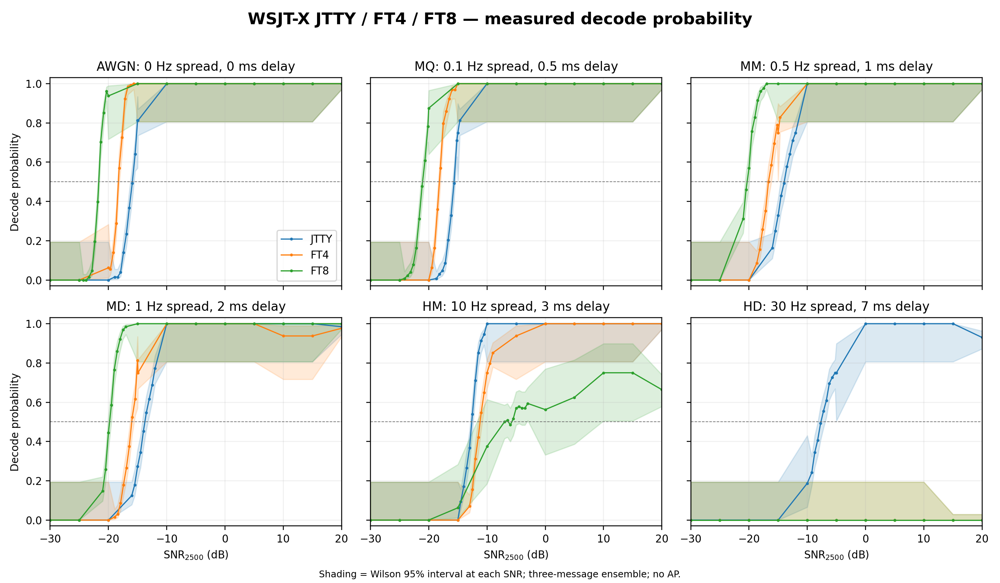
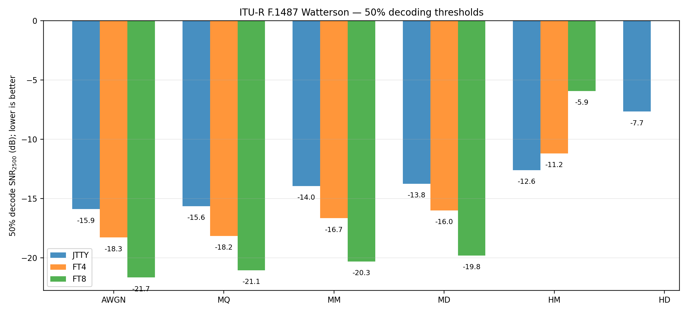
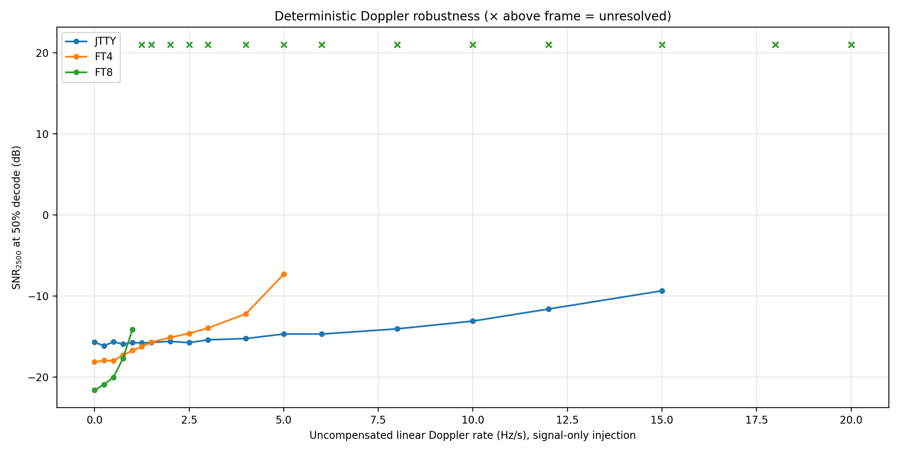

# WSJT-X JTTY / FT4 / FT8：精细信道鲁棒性测试（75 条件）

## 来源与验收

本报告仅采用 2026-10-14 至 15 日完成的实际测试数据，未使用上一轮测量替代。
- GitHub Actions 运行： https://github.com/Iu-yang1/wsjtx/actions/runs/38651945004
- 固定实验代码 commit： c25673947dd43529afbfab89e69fe2dda85fc744（bench/refined-channel-robustness）
- 启动提交： 70966e578f24a58577bb3f10b05c9112e19b6990
- 已验证 75/75 条件、81,872 条 per-trial 记录、1,267 个 SNR 点；50 个 SNR50 可估计，其余 25 个标记为错误平台或未交叉。
- 九组 measured 原始 trials/points 与汇总文件逐条一致；每个条件有三种合法呼号消息，跨 SNR 共同随机数种子一致。

## Watterson / AWGN 50% 解码门限

|信道|JTTY|FT4|FT8|
|---|---:|---:|---:|
|AWGN|-15.90|-18.29|-21.67|
|MQ|-15.65|-18.17|-21.05|
|MM|-13.95|-16.67|-20.32|
|MD|-13.75|-16.00|-19.81|
|HM|-12.61|-11.19|-5.93|
|HD|-7.66|未解析|未解析|

数值为 SNR2500（dB），越负代表在本实验配置下更弱信号即可达到 50% 的精确消息解码成功率。未解析不是零值，也不能外推其门限。
AWGN：JTTY −15.90 dB，FT4 −18.29 dB，FT8 −21.67 dB；HD（30 Hz/7 ms）下 JTTY 为 −7.66 dB，FT4/FT8 在 +20 dB 端点均未成功解码。

## 未补偿多普勒率

测试为发射波形加 0–20 Hz/s 线性 chirp 后叠加 AWGN，不含 Watterson 复合衰落及接收端动态补偿。可估计 SNR50 的最大测试变化率：JTTY 15 Hz/s、FT4 5 Hz/s、FT8 1 Hz/s。

## 统计与高 SNR 错误平台

FT8 的 HM（10 Hz/3 ms）虽然拟合 SNR50 为 −5.93 dB，但 +20 dB 的解码成功率为 85/128（66.4%）。高 SNR 平台不能用单一 SNR50 完整描述。
使用固定 -30 至 +20 dB 的 5 dB 粗网格（16 trials/点）及 0.5 dB 密集网格（128 trials/点）。点概率的 Wilson 95% 区间不等同于门限的不确定性；门限区间基于 Jeffreys-Beta 抽样与加权单调回归，不能覆盖系统建模误差。同一 trial_index 的 seed 在不同 SNR 点复用，跨 SNR 样本不独立。

## 对照 QEX 2020

Franke / Somerville / Taylor, The FT4 and FT8 Communication Protocols, QEX 2020：https://wsjt.sourceforge.io/FT4_FT8_QEX.pdf 。本轮与论文的解码器版本、信道统计和消息集合并不完全一致，不应把门限差异直接解释为算法改进。
|信道|本轮FT4|QEX FT4|本轮FT8|QEX FT8|
|---|---:|---:|---:|---:|
|AWGN|−18.29|−17.5|−21.67|−20.8|
|MD|−16.00|−15.2|−19.81|−18.6|
|HM|−11.19|−12.2|−5.93|−8.6|

## 完整 75 条件汇总

|模式|分组|条件|SNR50/dB|状态|高端 SNR 正确率|
|---|---|---|---:|---|---:|
|FT4|drift-high|RATE_04.00|-12.21|estimated|1.0000|
|FT4|drift-high|RATE_05.00|-7.33|estimated|1.0000|
|FT4|drift-high|RATE_06.00|未解析|no_P50_error_floor|0.0000|
|FT4|drift-high|RATE_08.00|未解析|no_P50_error_floor|0.0000|
|FT4|drift-high|RATE_10.00|未解析|no_P50_error_floor|0.0000|
|FT4|drift-high|RATE_12.00|未解析|no_P50_error_floor|0.0000|
|FT4|drift-high|RATE_15.00|未解析|no_P50_error_floor|0.0000|
|FT4|drift-high|RATE_18.00|未解析|no_P50_error_floor|0.0000|
|FT4|drift-high|RATE_20.00|未解析|no_P50_error_floor|0.0000|
|FT4|drift-low|RATE_00.00|-18.14|estimated|1.0000|
|FT4|drift-low|RATE_00.25|-17.97|estimated|1.0000|
|FT4|drift-low|RATE_00.50|-17.98|estimated|1.0000|
|FT4|drift-low|RATE_00.75|-17.32|estimated|1.0000|
|FT4|drift-low|RATE_01.00|-16.74|estimated|1.0000|
|FT4|drift-low|RATE_01.25|-16.25|estimated|1.0000|
|FT4|drift-low|RATE_01.50|-15.73|estimated|1.0000|
|FT4|drift-low|RATE_02.00|-15.12|estimated|1.0000|
|FT4|drift-low|RATE_02.50|-14.63|estimated|1.0000|
|FT4|drift-low|RATE_03.00|-13.96|estimated|1.0000|
|FT4|spread|AWGN|-18.29|estimated|1.0000|
|FT4|spread|HD|未解析|no_P50_error_floor|0.0000|
|FT4|spread|HM|-11.19|estimated|1.0000|
|FT4|spread|MD|-16.00|estimated|0.9766|
|FT4|spread|MM|-16.67|estimated|1.0000|
|FT4|spread|MQ|-18.17|estimated|1.0000|
|FT8|drift-high|RATE_04.00|未解析|no_P50_error_floor|0.0000|
|FT8|drift-high|RATE_05.00|未解析|no_P50_error_floor|0.0000|
|FT8|drift-high|RATE_06.00|未解析|no_P50_error_floor|0.0000|
|FT8|drift-high|RATE_08.00|未解析|no_P50_error_floor|0.0000|
|FT8|drift-high|RATE_10.00|未解析|no_P50_error_floor|0.0000|
|FT8|drift-high|RATE_12.00|未解析|no_P50_error_floor|0.0000|
|FT8|drift-high|RATE_15.00|未解析|no_P50_error_floor|0.0000|
|FT8|drift-high|RATE_18.00|未解析|no_P50_error_floor|0.0000|
|FT8|drift-high|RATE_20.00|未解析|no_P50_error_floor|0.0000|
|FT8|drift-low|RATE_00.00|-21.64|estimated|1.0000|
|FT8|drift-low|RATE_00.25|-20.92|estimated|1.0000|
|FT8|drift-low|RATE_00.50|-20.04|estimated|1.0000|
|FT8|drift-low|RATE_00.75|-17.71|estimated|1.0000|
|FT8|drift-low|RATE_01.00|-14.14|estimated|1.0000|
|FT8|drift-low|RATE_01.25|未解析|no_P50_error_floor|0.1953|
|FT8|drift-low|RATE_01.50|未解析|no_P50_error_floor|0.0000|
|FT8|drift-low|RATE_02.00|未解析|no_P50_error_floor|0.0000|
|FT8|drift-low|RATE_02.50|未解析|no_P50_error_floor|0.0000|
|FT8|drift-low|RATE_03.00|未解析|no_P50_error_floor|0.0000|
|FT8|spread|AWGN|-21.67|estimated|1.0000|
|FT8|spread|HD|未解析|no_P50_error_floor|0.0000|
|FT8|spread|HM|-5.93|estimated|0.6641|
|FT8|spread|MD|-19.81|estimated|1.0000|
|FT8|spread|MM|-20.32|estimated|1.0000|
|FT8|spread|MQ|-21.05|estimated|1.0000|
|JTTY|drift-high|RATE_04.00|-15.26|estimated|1.0000|
|JTTY|drift-high|RATE_05.00|-14.70|estimated|1.0000|
|JTTY|drift-high|RATE_06.00|-14.71|estimated|1.0000|
|JTTY|drift-high|RATE_08.00|-14.06|estimated|1.0000|
|JTTY|drift-high|RATE_10.00|-13.11|estimated|1.0000|
|JTTY|drift-high|RATE_12.00|-11.62|estimated|1.0000|
|JTTY|drift-high|RATE_15.00|-9.37|estimated|1.0000|
|JTTY|drift-high|RATE_18.00|未解析|no_P50_error_floor|0.0000|
|JTTY|drift-high|RATE_20.00|未解析|no_P50_error_floor|0.0000|
|JTTY|drift-low|RATE_00.00|-15.72|estimated|1.0000|
|JTTY|drift-low|RATE_00.25|-16.15|estimated|1.0000|
|JTTY|drift-low|RATE_00.50|-15.67|estimated|1.0000|
|JTTY|drift-low|RATE_00.75|-15.95|estimated|1.0000|
|JTTY|drift-low|RATE_01.00|-15.74|estimated|1.0000|
|JTTY|drift-low|RATE_01.25|-15.82|estimated|1.0000|
|JTTY|drift-low|RATE_01.50|-15.74|estimated|1.0000|
|JTTY|drift-low|RATE_02.00|-15.61|estimated|1.0000|
|JTTY|drift-low|RATE_02.50|-15.77|estimated|1.0000|
|JTTY|drift-low|RATE_03.00|-15.42|estimated|1.0000|
|JTTY|spread|AWGN|-15.90|estimated|1.0000|
|JTTY|spread|HD|-7.66|estimated|0.9297|
|JTTY|spread|HM|-12.61|estimated|1.0000|
|JTTY|spread|MD|-13.75|estimated|0.9844|
|JTTY|spread|MM|-13.95|estimated|1.0000|
|JTTY|spread|MQ|-15.65|estimated|1.0000|

## 数据文件与限制

- data/trials.csv：81,872 次模拟的消息、种子和解码结果；data/points.csv：1,267 个概率点；data/thresholds.csv：门限及其区间。
- data/measured/：九组 Actions measured 产物的原始 CSV、results.json 和日志；figures/：Actions 生成的 PNG/SVG 图；audit.json：归档核验；SHA256SUMS.txt：文件哈希。
- 实验协议：https://github.com/Iu-yang1/wsjtx/blob/c25673947dd43529afbfab89e69fe2dda85fc744/tools/channel-bench/REFINED_QEX_PROTOCOL.md

不同模式的时长、载荷、同步及解码设置不同；这些是仿真下特定消息集合的相对性能结果，而不是 OTA 实机测试或等比特吞吐量性能对照。
